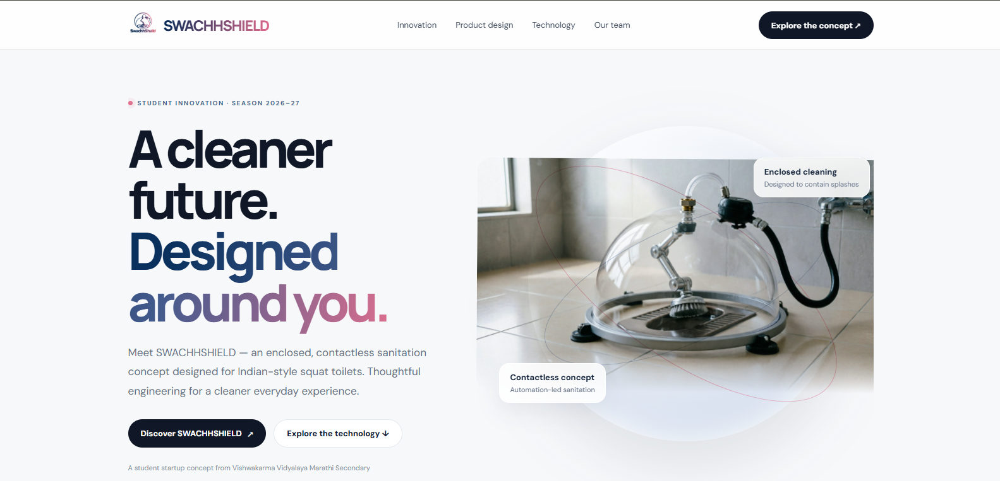
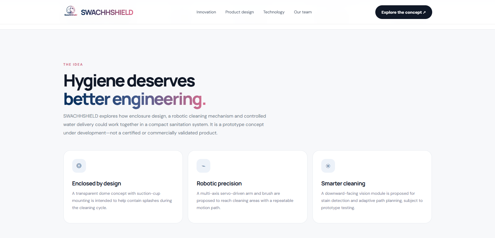
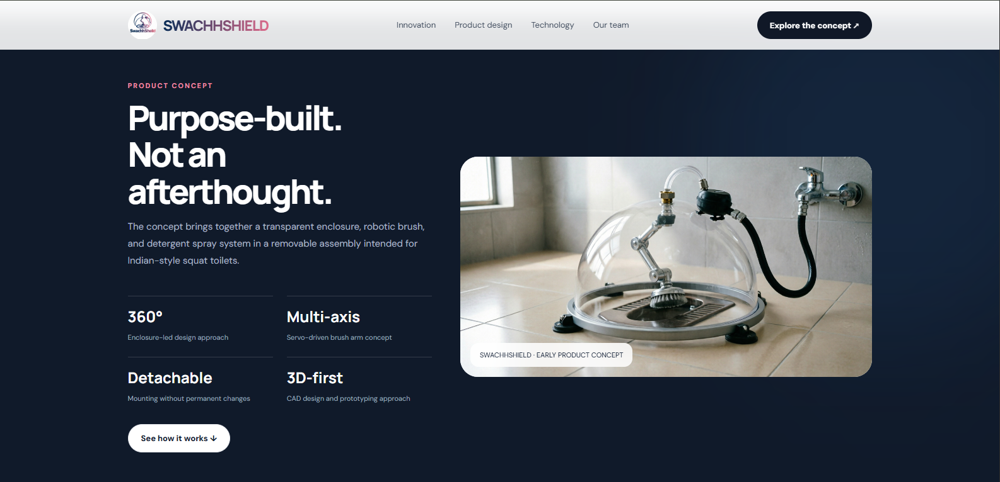
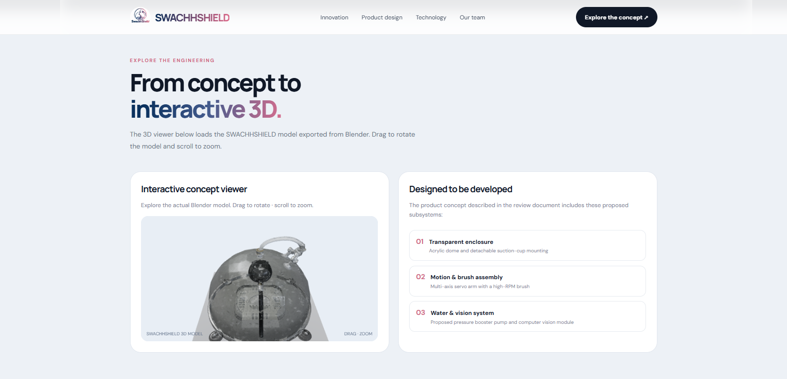
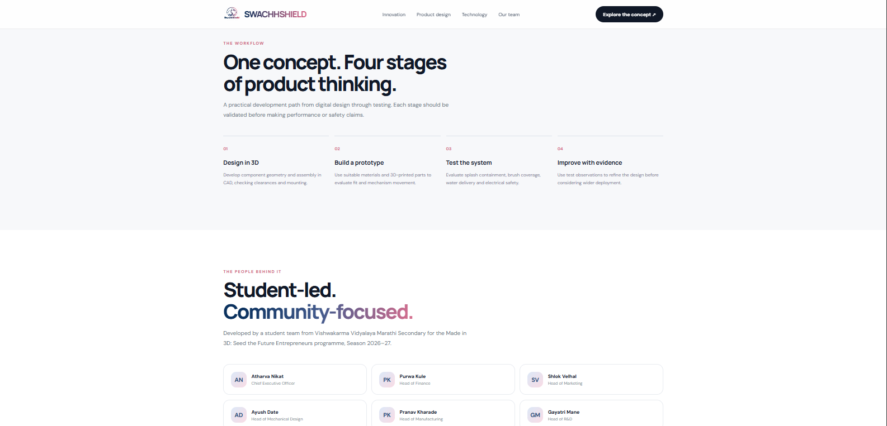
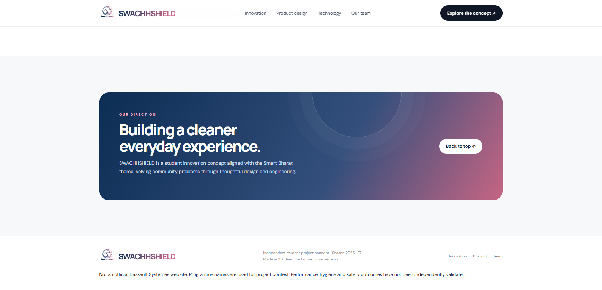

# SwachhShield

**Official SwachhShield Student Project Website**

SwachhShield is an innovative student project focused on developing a smart toilet-cleaning solution through technology, automation, and creative engineering.

---

## 🌐 Live Website

Explore our project here:

**[Visit SwachhShield Website](https://swachhshield.github.io/swachhsheild-website/)**

---

## 📸 Website Preview

### 1. Homepage

### 2. About

### 3. Features

### 4. 3D Design

### 5. Workflow

### 6. The People Behind It

---

## 💡 Our Vision

To develop an innovative and practical cleaning solution that promotes hygiene through smart engineering and automation.

---

## 🛠️ Project Technologies

- 3D Design and Modelling
- Mechanical Engineering
- Automation
- Web Development

---

## 📩 Project Information

**Project Name:** SwachhShield

**Tagline:** Cleans Toilet

**Category:** Student Innovation Project

---

© SwachhShield | All Rights Reserved.
